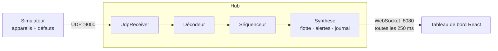

# PulseHub

Hub de supervision temps réel d'équipements scéniques qui émettent leur télémétrie en UDP (protocole PulseHub v1),
avec un simulateur de flotte et un tableau de bord web.

## 1. Démarrage local

Prérequis : Node.js 22 ou plus récent, npm 10 ou plus récent.

```bash
npm install
npm run dev                # hub + tableau de bord + simulateur, ouvre http://localhost:5173
npm run dev -- --chaos     # avec tous les défauts injectés
```

Lancement séparé : `npm run hub`, `npm run dashboard`, `npm run sim` (options : `npm run sim -- --help`).
Tests : `npm test` · types : `npm run typecheck`.
Configuration : variables d'environnement ([.env.example](.env.example)) et règles d'alerte ([config/alert-rules.json](config/alert-rules.json)).

**Tester un défaut :** au démarrage tout est à zéro, puis par exemple :

| Commande | À regarder |
|---|---|
| `npm run dev -- --bad-checksum 0.05` | Messages abîmés |
| `npm run dev -- --duplicate 0.05` | Reçus en double |
| `npm run dev -- --reorder 0.05` | Arrivés en retard, Messages perdus |
| `npm run dev -- --anomaly 0.01` | Valeurs anormales détectées |
| `npm run dev -- --hot 2 --hot-after 1` | appareils 1 et 2 en Danger après 3 s au-dessus de 70 °C |
| `npm run dev -- --stop 2 --stop-after 3` | appareils 49 et 50 « Ne répond plus » |

## 2. Architecture



Une trame est reçue par `UdpReceiver`, validée par le décodeur (taille, magic, version, longueur, checksum),
puis le séquenceur écarte doublons et retards et compte les pertes par appareil.
La synthèse met à jour l'appareil et ses alertes ; toutes les 250 ms, un instantané JSON part vers le navigateur.

## 3. Synthèse et visualisation

La synthèse contient :
- **réception** : débit, invalides par motif, doublons, retards, pertes et taux de perte ;
- **flotte** : nombre d'appareils OK, à surveiller, en danger, hors ligne, valeurs anormales, température max et moyenne ;
- **appareils** : dernières valeurs, alertes actives avec durée (ex. > 70 °C pendant 3 s) et consigne à suivre ;
- **journal** des derniers événements.

Pour une régie, l'essentiel est de savoir vite **quel appareil** pose problème et **quoi faire** : un bandeau résume la situation en une phrase,
les appareils en difficulté passent en tête.
Interface web choisie car lisible par toute l'équipe et rapide à faire évoluer dans la journée ; le front partage les types du hub ([snapshot.ts](src/hub/synthesis/snapshot.ts)).

## 4. Principes de conception

| Principe | Où |
|---|---|
| **Responsabilité unique** : le décodeur décode, le récepteur UDP ignore le protocole | [decoder.ts](https://github.com/Victan78/pulsehub/blob/b4663b5915d467bdc8b16ea1bc0573eeb710ca50/src/protocol/decoder.ts#L29-L75), [udp-receiver.ts](https://github.com/Victan78/pulsehub/blob/b4663b5915d467bdc8b16ea1bc0573eeb710ca50/src/hub/udp-receiver.ts#L12-L48) |
| **Séparation des responsabilités** : le Hub enchaîne décodage, séquencement et synthèse sans connaître le réseau | [hub.ts](https://github.com/Victan78/pulsehub/blob/b4663b5915d467bdc8b16ea1bc0573eeb710ca50/src/hub/hub.ts#L18-L41) |
| **Injection de dépendances** : composants reliés dans une racine de composition, horloge et réseau injectés pour les tests | [main.ts](https://github.com/Victan78/pulsehub/blob/b4663b5915d467bdc8b16ea1bc0573eeb710ca50/src/hub/main.ts#L15-L27), [simulator.ts](https://github.com/Victan78/pulsehub/blob/b4663b5915d467bdc8b16ea1bc0573eeb710ca50/src/simulator/simulator.ts#L7-L14) |
| **Ouvert/fermé** : une alerte s'ajoute dans le JSON sans toucher au moteur | [alert-engine.ts](https://github.com/Victan78/pulsehub/blob/b4663b5915d467bdc8b16ea1bc0573eeb710ca50/src/hub/synthesis/alert-engine.ts#L33-L58) |
| **DRY** : un seul contrat de synthèse pour le hub et le front | [snapshot.ts](https://github.com/Victan78/pulsehub/blob/b4663b5915d467bdc8b16ea1bc0573eeb710ca50/src/hub/synthesis/snapshot.ts#L1-L8) |
| **Erreurs** : une trame invalide est un résultat, pas une exception ; le hub ne plante jamais | [decoder.ts](https://github.com/Victan78/pulsehub/blob/b4663b5915d467bdc8b16ea1bc0573eeb710ca50/src/protocol/decoder.ts#L29-L33) |

## 5. Choix et compromis

- **Outils :** TypeScript + tsx (lance le `.ts` sans étape de build), vitest (tests rapides sans configuration), ws (WebSocket minimal), React + Vite (composants et démarrage en une commande), Fontsource (polices embarquées, la régie peut être hors ligne). UDP, CLI et binaire avec les modules natifs de Node (`dgram`, `parseArgs`, `Buffer`). Écartés : NestJS et Socket.IO (trop lourds pour un seul flux), Grafana (installation trop longue pour la journée), une interface terminal (moins lisible pour 50 appareils).
- **Pertes :** comptées par appareil à partir des trous de `seq`. Une trame arrivée après une plus récente est écartée et déjà comptée comme perdue.
- **Bonus faits :** alertes avec durée, retour à zéro de `seq` et redémarrage d'appareil, seuils d'alerte en JSON.
- **Simplifié :** synthèse en mémoire uniquement ; seules les règles d'alerte sont configurables, pas toute la chaîne de traitement.

## 6. Limites connues

- Pas d'historique après l'arrêt du hub.
- Le protocole ne donne pas le type d'appareil : tous ont les mêmes règles.
- Un redémarrage dans les 5 premières secondes de fonctionnement n'est pas détecté.
- Débit maximal du hub non mesuré ; le simulateur envoie environ 950 trames/s au lieu de 1 000 (cadence par `setInterval`).
- Pas d'intégration continue.

## 7. Usage de l'IA

- **Claude Code** (Claude Opus 5.5) : aide à challenger l'architecture et aux tests
- **gpt-image-2.5** (via Replicate) : les 4 illustrations 3D des appareils.

Chaque commit a été relu et testé 
